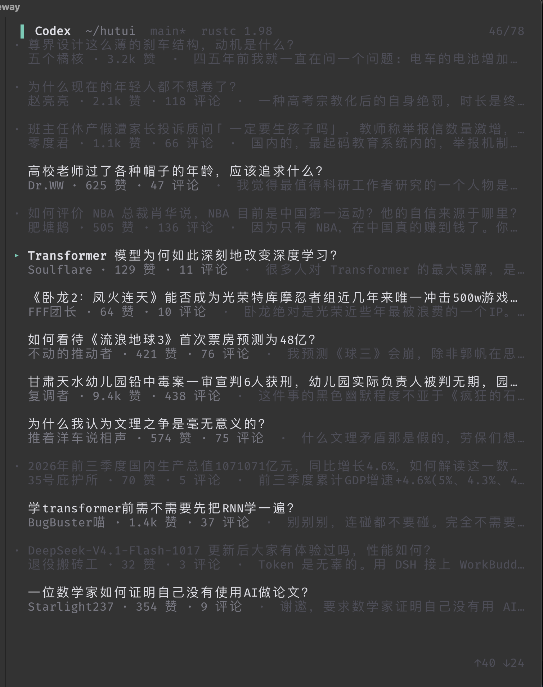
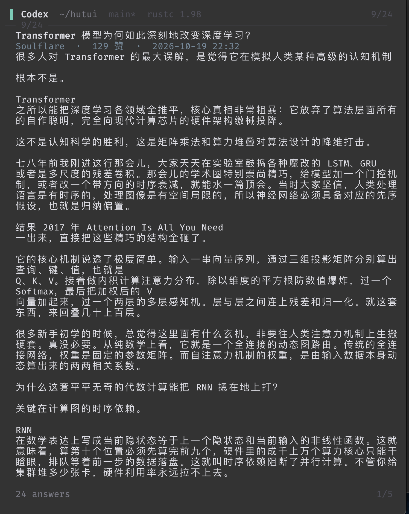
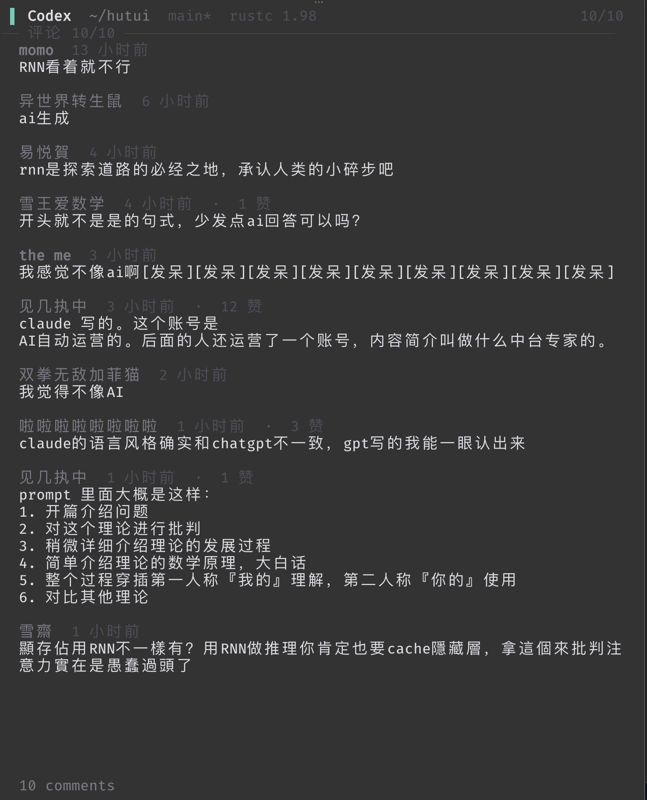

# hutui

在终端里读知乎的 TUI —— 界面做成 Codex CLI 的样子，摸鱼时看起来像在跑代码。

`hutui` = 知乎的「乎」+ TUI。名字特意挑了 GitHub 零命中、无商标联想的组合，
这样 `ps` 里看不到「zhihu」两个字。

[](#license)
[](#要求)

## 一句话开始

macOS，装好 Google Chrome，复制这一行：

```bash
curl -fsSL https://github.com/LeonJob1492/hutui/releases/latest/download/hutui-universal-apple-darwin.tar.gz | tar xz && ./hutui
```

解出来是一个 **1.8 MB 通用二进制**（Intel + Apple Silicon 都能跑，已带执行权限），
不需要装 Rust 工具链。想收进 PATH：

```bash
install -m 755 hutui /usr/local/bin/
```

第一次运行会后台拉起一个**独立 profile** 的 Chrome，窗口停在知乎：在里面登录一次，
回到终端按 `r` 就有内容了。登录态存在 `~/.hutui/chrome-profile`，之后不用再登。

> 用 `curl` 下载不会带 macOS 的 quarantine 标记，所以能直接跑。
> 如果你是在浏览器里点下载的，首次执行会被 Gatekeeper 拦下，
> `xattr -d com.apple.quarantine ./hutui` 解掉即可。

## 它是什么

一个跑在终端里的知乎阅读器，**复用你自己浏览器里已经登录的会话**，只做展示和少量互动。

它**不是**爬虫：不伪造签名、不伪造 UA、不碰任何登录凭证以外的接口权限。
所有请求都是在你自己那个已登录的浏览器页面里发的，用的就是你的 cookie。

## 界面

三个视图，外加一个应急画面。

### 列表

<p align="center">
  
</p>

顶栏那行 `▌ Codex  ~/hutui  main*  rustc 1.98` 是伪装本身——它永远长这样，不随内容变化。

- 右上 `46/78`：当前是第 46 条，本地已拉取 78 条
- 右下 `↑40 ↓24`：视口上方 / 下方还压着多少条
- 看过的条目整条变灰、行首 `▸` 变 `·`，记录存在 `~/.hutui/read.json`，重启后仍在
- 滚到底自动续拉下一页

### 阅读

<p align="center">
  
</p>

- 顶上 `── 9/24 ──`：同一个问题下第 9 条回答，共 24 条；左下 `24 answers` 是拉取时的提示
- 标题 / 作者 / 赞数 / 时间那三行**吸顶不动**，只有正文滚动
- 右下 `1/5`：本条回答的第 1 屏，共 5 屏
- `↑` `↓` 先在本条内翻屏，翻到边界才换条；`n` / `p` 只换条不翻屏

### 评论区

<p align="center">
  
</p>

- 顶上 `评论 10/10`：已加载 10 条，共 10 条
- 楼中楼只显示 `└ N 条回复` 计数，不展开
- 只读：不发评论、不回复；到底后 `Enter` 加载下一页（没有下一页就不响应）

### 应急画面

`Esc` 连按两下（或 `Ctrl-H`）整个视口重绘成一屏静止的 `cargo test` 输出。
静止是刻意的：会滚动的画面反而吸引注意，而且零动效 = 零半帧风险。
进入后只认这两个组合（外加 `Ctrl-C` 退出程序），其他键一律不响应——
手一抖按到空格不该把正文请回来。

## 功能

- 推荐流列表，已读置灰并持久化；滚到底自动续拉
- 一条一屏阅读，同问题内 ↑↓ 切换，每条各自记住滚动位置
- 赞 / 反对 / 收藏（都是开关，状态显示在标题下面那行）
- 评论区只读浏览，分页加载
- 整体宽度限制 1024px 居中，超宽终端两侧留白
- 中文按显示宽度换行，带行首禁则（标点不会掉到行首）

## 键位

| 视图 | 键 | 动作 |
|---|---|---|
| 列表 | `↑` `↓` / `k` `j` | 移动光标 |
| | `Home` `End` | 跳到首条 / 末条 |
| | `→` / `Enter` | 打开当前条 |
| | `空格` / `r` | 整份重新拉取推荐流 |
| | 滚到底 | 自动续拉下一页 |
| 阅读 | `↑` `↓` / `k` `j` | 先在本条内翻屏，到顶 / 底才换上 / 下一条 |
| | `PgUp` `PgDn` | 只翻屏，不换条 |
| | `n` `p` | 只换条，不翻屏 |
| | `Home` `End` | 本条开头 / 最后一屏 |
| | `z` | 赞 / 取消赞 |
| | `v` | 反对 / 取消反对 |
| | `c` | 收藏 / 取消收藏 |
| | `x` | 打开评论区 |
| | `←` / `Backspace` | 返回列表 |
| 评论区 | `↑` `↓` / `k` `j` | 逐行滚动 |
| | `PgUp` `PgDn` `Home` `End` | 翻页 / 跳首尾 |
| | `Enter` | 加载下一页评论 |
| | `x` / `←` / `Backspace` | 回阅读 |
| 任意 | `Esc` `Esc`（520 ms 内）或 `Ctrl-H` | 进入 / 退出应急画面 |
| 任意 | `q` / `Ctrl-C` | 退出 |

macOS 上 `Ctrl-H` 经常被终端编码成 `Ctrl-Backspace`，两个都认。

## 安装

### A. 预编译二进制（推荐）

不装 Rust，下载就能跑。两种拿法：

**curl 一行流** —— 没 quarantine 标记，直接可用：

```bash
curl -fsSL https://github.com/LeonJob1492/hutui/releases/latest/download/hutui-universal-apple-darwin.tar.gz | tar xz
chmod +x hutui
./hutui
```

**去 Releases 页手动下载** —— `hutui-universal-apple-darwin.tar.gz` 和它的 `.sha256`。
浏览器下载的文件会被打上 quarantine，首次执行要放行一次：

```bash
xattr -d com.apple.quarantine ./hutui
```

校验（可选）：

```bash
curl -fsSLO https://github.com/LeonJob1492/hutui/releases/latest/download/hutui-universal-apple-darwin.tar.gz.sha256
shasum -a 256 -c hutui-universal-apple-darwin.tar.gz.sha256
```

### B. 从源码装（需要 Rust 1.80+）

不想用预编译包，或者想跟最新提交：

```bash
cargo install --git https://github.com/LeonJob1492/hutui.git
```

本地编译出来的是普通文件、没有 quarantine，同样不会触发 Gatekeeper。

### C. 仓库内构建

```bash
git clone https://github.com/LeonJob1492/hutui.git
cd hutui
cargo run --release
```

## 要求

| 项 | 要求 |
|---|---|
| 系统 | macOS（Chrome 的启动方式和 `open` 命令都是 macOS 专属，Linux / Windows 暂不支持） |
| 浏览器 | Google Chrome，装在默认位置 |
| 终端 | 任一带 256 色的终端；Ghostty 下窗口标题伪装效果最好 |
| Rust | 只有 B / C 两种安装方式需要，1.80+ |
| 磁盘 | 二进制 1.8 MB，`~/.hutui/chrome-profile` 是独立 Chrome profile，几十 MB 起 |

## 首次运行

1. 启动后会在后台拉起一个独立 profile 的 Chrome（`open -n -g`，不抢焦点），停在知乎；
2. 在那个窗口登录知乎；
3. 回到终端按 `r` 重新拉取。

调试端口固定 `9222`；这个实例和你日常用的 Chrome 完全隔离，不影响原来的浏览器。

## 工作原理

```
┌──────────────────────────────┐
│ hutui (Rust + ratatui)       │  主线程：渲染 + 事件循环
│   bridge/  ── 后台线程       │
└───────────┬──────────────────┘
            │ CDP over ws://127.0.0.1:9222
┌───────────┴──────────────────┐
│ 独立 Chrome 实例              │  只有一件事：提供一个
│ ~/.hutui/chrome-profile      │  带登录 cookie 的同源上下文
└──────────────────────────────┘
```

取数就是在那个页面里发一次 `fetch`，通过 CDP 的 `Runtime.evaluate` 把 JSON 取回来。
**不模拟点击、不模拟滚动、不解析 DOM** —— 页面的作用只是"带着你的登录态"。

用到的接口：

| 用途 | 接口 |
|---|---|
| 推荐流 | `GET /api/v3/feed/topstory/recommend`，跟随 `paging.next` 翻页 |
| 单篇回答 | `GET /api/v4/answers/{aid}` |
| 同问题回答 | `GET /api/v4/questions/{qid}/answers`，按 `offset` 翻页，`paging.totals` 给总数 |
| 评论 | `GET /api/v4/answers/{aid}/comments` |
| 赞 / 反对 | `POST /api/v4/answers/{aid}/voters` |
| 收藏 | `POST /api/v4/collections/{cid}/contents`、`DELETE /api/v4/collections/contents/answer/{aid}` |

写操作只需要 `x-xsrftoken`（页面里 `_xsrf` cookie 的值）。

## 目录结构

```
src/main.rs          入口、事件循环
src/app.rs           状态机（列表 / 阅读 / 评论区 / 应急）+ 按键
src/state.rs         已读记录
src/term.rs          终端生命周期、OSC 2 窗口标题、panic hook
src/text.rs          中文换行、截断、数字压缩、时间格式化
src/ui/              list · reading · comments · panic · theme
src/zhihu/           领域模型与接口解析
src/bridge/          Chrome 生命周期、CDP 客户端、采集线程
docs/screenshots/    README 用的界面截图
```

## 边界与免责

- **只读为主**：除了赞 / 反对 / 收藏，不写任何东西；评论不发、不回复。
- **不绕付费墙**：盐选等付费正文本来就不在返回数据里，拿不到就是拿不到。
- **不重写签名算法、不伪造客户端身份**：所有请求都发生在你自己的浏览器上下文里。
- 知乎随时可能改接口；`src/zhihu/parse.rs` 是唯一需要跟着改的地方。
- 请自行确认这样使用是否符合你所在环境的规定。作者不对使用后果负责。

## 调试

每一步的网络耗时写到 `~/.hutui/trace.log`，形如：

```
19:02:11.123 cmd Vote queued=3ms
19:02:11.936 POST /api/v4/answers/2095.../voters cdp=812ms fetch=760ms deliver=3ms
```

- `queued` 命令在队列里等了多久
- `cdp` 整个 `Runtime.evaluate` 一来一回
- `fetch` 页面里那次 fetch 自己的耗时
- `deliver` 页面算完到我们收到结果之间（和 fetch 一起看，就知道慢在服务端还是链路）

赞 / 收藏是**乐观更新**：按键当下就变，服务端回包只是校正，失败才回滚——所以即便知乎那边
要几秒，你也不会觉得"按了没反应"。

## 已知限制

- 只完整支持「回答」；文章 / 想法的阅读分支还没做（列表里会标出来）
- 不显示图片，图片位置显示 `[图]`
- **付费 / 盐选内容直接过滤掉**：网页接口只给开头预览 + 一句「去 App 查看完整内容」，
  这种残缺内容不进列表
- 收藏没有初态字段：如果这条本来就在收藏夹里，第一次按 `c` 是一次幂等的重复添加
- 评论区只读，不支持发评论
- 依赖本机 Chrome，没做 Firefox / Safari 适配
- 只支持 macOS，Linux / Windows 未做适配

## 更多文档

- `docs/design.md` —— 设计文档（数据链路、架构、实测结论，实现的唯一事实源）

## License

双许可，任选其一：

- [MIT](LICENSE-MIT)
- [Apache-2.0](LICENSE-APACHE)

```
SPDX-License-Identifier: MIT OR Apache-2.0
```

代码许可是 MIT / Apache-2.0，**不覆盖**你在里面读到的知乎内容，也不构成对任何服务
服务条款的背书——请自行确认使用场景是否合规。
